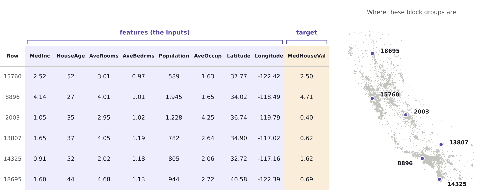
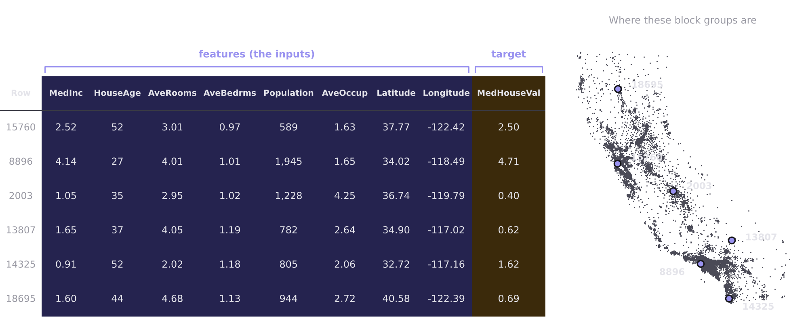
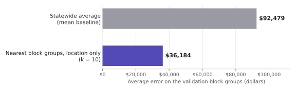
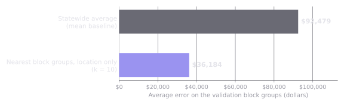

Suppose a state housing agency asks you for the median home value of every neighborhood in California. You have reliable figures for some neighborhoods and nothing for the rest, along with a few facts that are available everywhere, such as how old the housing is, how many rooms the homes have, what people earn, and where each neighborhood sits on the map. How would you fill in the missing values, and how would you know whether to trust what you produced?

This is a supervised learning problem, and most of what this book does with tabular data, imagery, and pretrained models is a variation on it. You have examples where the answer is known, you build something that produces answers from the available facts, and you check whether it works on examples it has not seen. If you sorted cards in the first class session, you have already done all three by hand. This chapter gives each step its proper name, shows what can go wrong at each one, and introduces the Python library you will use to do them at scale.

::: {.callout-note title="Learning objectives"}
By the end of this chapter you should be able to

- identify the observations, features, and target in a supervised learning problem, and explain why the unit of observation is a choice
- distinguish regression from classification and explain what is gained and lost by turning one into the other
- explain why every model should be compared against a baseline model, including a spatial one
- describe what it means to fit a model, and why the choice of loss function matters
- choose and interpret evaluation metrics for regression and classification
- recognize overfitting and underfitting and explain the role of training, validation, and test sets
- fit, evaluate, and compare models with scikit-learn
:::

## Features, targets, and observations

The running example for the tabular chapters is a dataset of housing values for California block groups, assembled from the 1990 census [@pace1997]. Each of its 20,640 rows describes one block group, a census unit that usually holds somewhere between several hundred and a few thousand people. Each row records the median income of the block group's households, the median age of its housing, the average number of rooms and bedrooms per household, its population, the average number of people per household, and the latitude and longitude of its center. The last column holds the median value of owner-occupied homes, which is the quantity we want to predict.

| Column | What it records |
|----|----|
| MedInc | Median household income, in tens of thousands of dollars |
| HouseAge | Median age of the housing, in years |
| AveRooms | Average number of rooms per household |
| AveBedrms | Average number of bedrooms per household |
| Population | Number of people in the block group |
| AveOccup | Average number of people per household |
| Latitude, Longitude | Location of the block group's center |
| MedHouseVal | Median home value, in hundreds of thousands of dollars (the target) |

: Columns of the California housing dataset {#tbl-housing-columns}

Each row is an **observation**, the unit about which the model makes a prediction. The columns used as inputs are **features**, and the column we want to predict is the **target**. You will see other names for the same ideas. Statisticians often say predictors or independent variables for features, and response or dependent variable for the target. In classification problems the target is usually called the **label**. These words mean the same thing across fields, and it is worth getting comfortable switching between them, because the papers you read will not agree on one.

One collision deserves a warning. In GIS, a feature is a geographic object, such as a point, line, or polygon. In machine learning, a feature is a column. The two meet in an awkward way, because a GIS attribute table is essentially a feature table in the machine learning sense, with one row per geographic feature and one column per machine learning feature. When the meaning is not obvious from context, this book says "geographic feature" for the GIS sense.

::: {.figblock}
{.light-content fig-alt="A table of six block groups from the California housing dataset, with the input columns grouped under the label features and the home value column labeled target, next to a map of California showing where each block group is."}

{.dark-content fig-alt="A table of six block groups from the California housing dataset, with the input columns grouped under the label features and the home value column labeled target, next to a map of California showing where each block group is."}

Six block groups from the dataset. Each row of the table is a place, and the same place is shown as a dot on the map. The numbers beside the dots match the first column of the table.
:::

Notice what the observation in this dataset actually is. It is not a house and it is not a household. It is a block group, a container drawn by the Census Bureau, and every value in the row is a summary of the people and homes inside it. A model trained on these rows predicts the median value of a block group. It says nothing direct about any individual home, and reading it that way is the ecological fallacy discussed in the chapter on spatial thinking. The choice of unit also shapes the data in less obvious ways. Block groups are drawn to hold similar numbers of people, so they are tiny in dense parts of Los Angeles and enormous in the desert, and a single row in the Mojave summarizes far more land than a row in Santa Monica. Someone chose this unit, and every model built on it inherits that choice.

## Regression and classification

Supervised learning problems come in two main types, and the type is set by the target. When the target is a number that can take many values, such as a home value or a temperature, the task is **regression**. When the target is a category, such as a land cover class or whether a neighborhood floods, the task is **classification**. A classification problem with two categories is **binary classification**, and one with more is **multiclass classification**.

The same data can often be framed either way. The housing values can be predicted directly in dollars, or each block group can be labeled as above or below the statewide median and predicted as a binary category, which is what the sorting activity in the first class session did. Turning a regression problem into a classification problem throws information away. A block group worth $490,000 and one worth $210,000 both become "below the median" if the median sits above them both, while one worth $310,000 lands on the other side of a block group worth $290,000 even though the two are nearly identical. The binary version is also easier in some ways, both for a model and for the people using it, and sometimes the decision you actually face is binary, such as whether a parcel should receive a flood inspection. The right framing depends on what the predictions will be used for, which is a question about the problem and not about the data.

Most classification models do not output a bare category. They output a probability for each category, such as a 0.83 chance that a block group is above the median, and a separate rule turns that probability into a decision. That rule matters more than it first appears, and the section on evaluation metrics returns to it.

## Baseline models

Before fitting anything sophisticated, fit something simple. A **baseline model** is a deliberately naive model that sets the bar every other model has to clear. For regression the standard baseline predicts the average target value from the training data for every observation, regardless of its features. For classification it predicts the most common category every time. These baselines know nothing, which is exactly what makes them useful. A model that cannot beat them has learned nothing worth using, however sophisticated it is.

Geographic data invites a second baseline that is far less naive. Predict each block group's value as the average of the values of its nearest neighbors on the map, using nothing but latitude and longitude. This model knows nothing about income, housing age, or rooms. It only knows where things are.

The location-only baseline does very well on the California data. Its average error on the validation set is about , against about  for the statewide average, which is much better than you might expect from a model that ignores every attribute of the neighborhoods it predicts. The reason is the first law of geography. Expensive block groups tend to sit next to other expensive block groups, so knowing the neighbors' values gets you most of the way to an answer. That success raises an uncomfortable question that will follow us through the next several chapters. When a more sophisticated model does well on this data, is it learning something about what makes housing valuable, or has it simply learned where the valuable places are? The chapter on spatial validation shows how to tell the difference.

::: {.figblock}
{.light-content fig-alt="Bar chart comparing the average validation error of the statewide average baseline with the location-only nearest neighbors baseline. The location-only bar is much shorter."}

{.dark-content fig-alt="Bar chart comparing the average validation error of the statewide average baseline with the location-only nearest neighbors baseline. The location-only bar is much shorter."}

Average error on the validation block groups for the two baselines. Shorter bars are better.
:::

## Fitting a model

A **model** is a family of possible functions that turn features into predictions, along with a set of adjustable numbers, called **parameters**, that pick out one member of the family. **Fitting** a model, also called **training** it, means searching for the parameter values that make the model's predictions match the training data as closely as possible.

The simplest example is a straight line. Suppose we predict home value from median income alone. Every straight line can be described by two parameters, an **intercept**, which is the predicted value when income is zero, and a **slope**, which is how much the predicted value rises for each additional unit of income. Linear regression is the family of all such lines, and fitting it means finding the intercept and slope that work best for the training data.

To say which line works best, we need to measure how wrong each line is. For any block group, the difference between its actual value and the value the line predicts is called the **residual**. On a scatter plot of income against home value, a residual is the vertical gap between a point and the line. A good line keeps those gaps small across all the training data. The standard version of linear regression, **least squares**, chooses the line that makes the total of the squared residuals as small as possible. For a straight line, the computer can find that best line exactly and almost instantly. For more complicated models, such as the neural networks later in the book, no such shortcut exists, and the computer instead searches by adjusting the parameters in small steps that each reduce the error a little.

The same idea extends to more features. Linear regression with eight features has one slope per feature, plus an intercept, and the fitted model predicts by adding up each feature times its slope. You can no longer draw it as a line on a page, but fitting it means exactly the same thing.

::: {.callout-tip title="Predict first"}
Move the line to make the error as small as you can before you reveal the answer. How close can you get?
:::



::: {.figcap}
Try switching between squared and absolute error. The next section explains the difference.
:::

## Loss functions

The quantity that fitting tries to make small is called the **loss function**, or simply the loss. Least squares uses one particular loss, but it is not the only reasonable choice, and the choice changes the model you get.

The two most common losses for regression are **mean squared error**, the average of the squared residuals, and **mean absolute error**, the average of the residuals with their signs dropped. They disagree about how much a large miss matters. Consider one prediction that misses by $100,000 and two predictions that each miss by $50,000. Under absolute error the two situations are equally bad, since both add up to $100,000 of error. Under squared error the single large miss counts twice as much as the two smaller ones combined, because squaring grows quickly. A model trained with squared error therefore works hard to avoid large misses, even at the cost of many small ones, and a few unusual observations can pull it a long way. A model trained with absolute error shrugs off those observations more easily.

The California data contains a set of observations that makes this difference concrete. The census recorded home values only up to $500,000, so every block group worth more than that appears in the data at exactly $500,000. There are  of these block groups, mostly along the coast. Their true values are unknown, only that they are at least $500,000, which statisticians call **censored** data. Under squared error, the stack of capped points at the top of the scatter plot pulls the fitted line toward them, while absolute error is pulled less. Neither loss fixes the underlying problem, which is that the target itself is wrong for some of the most expensive places in the state.

Try the loss toggle in the interactive above and watch where the best line goes.

Classification needs a different kind of loss. It might seem natural to train a classifier by maximizing its accuracy, the share of observations it gets right, but accuracy makes a poor loss. Nudging a model's parameters a little rarely flips any prediction from wrong to right, so accuracy usually does not change at all, and the search has no signal telling it which direction to move. Classifiers are instead trained with **log loss**, also called **cross-entropy loss**, which looks at the probability the model assigned to the correct category. A confident correct prediction costs almost nothing, a hesitant one costs a little, and a confident wrong prediction costs a great deal. Because probabilities change smoothly as parameters change, log loss always gives the search a direction to move in. You will meet it again when training neural networks.

Every loss described so far treats overprediction and underprediction as equally bad, and that is a decision, even when nobody makes it on purpose. In many geographic applications the two kinds of error carry very different costs. A flood model that underestimates risk leaves people unprepared, while one that overestimates it costs some unnecessary inspections. Losses exist that penalize errors in one direction more heavily than the other, and choosing among them is a judgment about whose errors matter more.

::: {.callout-tip title="Discuss"}
You are building a model to predict household wealth for a program that sends cash transfers to the poorest neighborhoods in a region. Which is worse, a model that overestimates wealth in poor places or one that underestimates it in wealthy places? Who bears the cost of each error, and how would you want the loss function to reflect that?
:::

## Evaluation metrics

A loss function serves the fitting process. An **evaluation metric** serves the people judging the model. Sometimes they are the same quantity, but often they are not, because a good metric has to be meaningful to a person reading it, while a good loss has to be convenient for the search. Metrics are always computed on data the model did not train on, for reasons the next section makes clear.

### Metrics for regression

**Mean absolute error** and **root mean squared error**, the square root of mean squared error, both report error in the units of the target, which makes them easy to interpret. A mean absolute error of $40,000 means the model's predictions are off by $40,000 on average. Root mean squared error is always at least as large as mean absolute error, and a big gap between the two tells you that a few large errors are inflating it.

The **coefficient of determination**, written **R²**, measures something different. It compares the model's squared error to the squared error of the mean baseline from earlier in the chapter, and reports how much of the baseline's error the model eliminates. An R² of 1 means perfect predictions. An R² of 0 means the model does no better than predicting the average every time. R² can also be negative, which means the model is worse than that baseline. That sounds impossible but happens regularly in GeoAI, usually when a model trained in one place or time is applied to another. R² has no units, so it is convenient for comparing models across datasets, but it hides how large the errors actually are. Report it alongside an error in real units.

### Metrics for classification

For a binary classifier, every prediction falls into one of four outcomes. Using "above the median" as the positive class, a **true positive** is an above-median block group the model correctly calls above, a **false positive** is a below-median block group the model wrongly calls above, a **true negative** is a below-median block group correctly called below, and a **false negative** is an above-median block group wrongly called below. Arranging the counts of these four outcomes in a two-by-two table gives the **confusion matrix**, and most classification metrics are ratios of its cells.

**Accuracy** is the share of all predictions that are correct. It is intuitive and frequently misleading. Imagine a model that flags parcels at high flood risk in a city where only 5 percent of parcels are actually high risk. A model that labels every parcel "low risk" achieves 95 percent accuracy and is completely useless. When one category is much rarer than the other, a situation called **class imbalance**, accuracy rewards ignoring the rare category, which is usually the one you care about.

Two metrics address this. **Precision** asks, of the observations the model flagged as positive, what share actually were. **Recall** asks, of the observations that actually were positive, what share the model caught. A flood model with high recall finds most of the high-risk parcels, and one with high precision rarely sends inspectors to safe parcels. The two pull against each other, and the lever that moves between them is the threshold.

Recall that classifiers usually output a probability. The **decision threshold** is the probability above which an observation is labeled positive. The default is 0.5, but nothing makes that value correct. Lowering the threshold flags more observations, which raises recall and usually lowers precision. Raising it does the opposite. Choosing a threshold is choosing a trade-off between kinds of mistakes, and like choosing a loss, it is a decision about consequences more than a technical setting.

::: {.callout-tip title="Predict first"}
Your agency will offer a home repair grant to block groups predicted to be below the median. A false negative means a struggling neighborhood is left out. A false positive means grant money goes to a neighborhood that did not need it. Before moving the slider, decide whether you would raise or lower the threshold from 0.5, and why.
:::



::: {.figcap}
In this explorer the positive class is "below the median," so that the grant scenario reads naturally and flagged block groups are the ones that would receive a grant. The explanation above used "above the median" as its example, so the four outcomes swap meaning between the two.
:::

## Overfitting and underfitting

A model is useful only if it works on data it has not seen. That ability is called **generalization**, and checking for it requires keeping some data away from the model during fitting. The standard practice, introduced in the chapter on building datasets, divides the data into three sets. The **training set** is used to fit the model. The **validation set** is used to compare models and tune their settings. The **test set** is set aside and used once, at the very end, to report how well the final model performs. The test set has to stay untouched for that final number to mean anything. Every time you look at test results and change something in response, the test set becomes a little more like a second validation set, and the number you report becomes a little more optimistic.

To see why this matters, consider a model called **k-nearest neighbors**. To predict a block group's value, it finds the k block groups in the training data that are most similar to it and averages their values. If similarity means distance on the map, this is the location-only baseline from earlier in the chapter, and k is the number of neighbors it averages. The value of k is not learned from the data. You choose it before fitting. Settings like this are called **hyperparameters**, to distinguish them from parameters, such as the slope of a line, which the fitting process finds on its own.

Now consider what happens as k changes. With k equal to 1, the model predicts each training block group's value by finding its single nearest neighbor in the training data. In principle that neighbor is the block group itself, so the training error would be zero and the model would have memorized the training data perfectly. In this dataset the training error comes out near  instead, because the coordinates are rounded and many block groups share exactly the same point, so a block group's nearest neighbor is sometimes a different block group at the same spot. Either way, the model has nearly memorized the training data. On the validation set, though, each prediction depends on a single neighbor, along with all of that neighbor's noise and quirks, and the error is much higher, about . This is **overfitting**, where a model fits the training data so closely that it captures noise along with the pattern, and generalizes poorly as a result.

At the other extreme, with k equal to the size of the training set, every prediction averages every training block group, and the model predicts the statewide average everywhere. It has become the mean baseline. Its training error and validation error are both high, because it is too simple to capture the pattern at all. This is **underfitting**.

Between these extremes, the validation error typically falls as k increases from 1, reaches a minimum, and then rises again as the model smooths away real differences between places. The training error, meanwhile, keeps rising the whole way. That U-shaped curve of validation error is one of the most important pictures in machine learning, and choosing a hyperparameter means finding the bottom of it.

The two failures have names that you will see often. A model that underfits has high **bias**, meaning it makes systematic errors because it is too simple to represent the real pattern. A model that overfits has high **variance**, meaning its predictions depend heavily on the particular training data it happened to see, and would change a lot if it were trained on a different sample. Adjusting model complexity trades one against the other, a relationship known as the **bias–variance trade-off**. The same trade-off appears with every model in this book, whether the dial is k, the depth of a decision tree, or the number of layers in a neural network.

::: {.callout-tip title="Predict first"}
Before moving the slider, sketch what you think the training error and the validation error will do as k goes from 1 to 1,000.
:::



There is one more thing to notice about this experiment, and the book will not resolve it yet. The validation set here was drawn at random from across California, so almost every validation block group has training block groups right next door. Hold on to that fact. The chapter on spatial validation reruns the same experiment with a different kind of split, and the bottom of the curve moves.

## The scikit-learn workflow

**scikit-learn** is the standard Python library for machine learning on tabular data [@pedregosa2011]. Its most useful feature is that nearly every model in it works the same way. You create a model object, fit it to the training data, and then use it to predict. Once you have learned that pattern for one model, you have learned it for hundreds.

The code below loads the housing data, sets aside a test set, splits the rest into training and validation sets, fits a linear regression, and reports its mean absolute error on the validation set.

```python
from sklearn.datasets import fetch_california_housing
from sklearn.model_selection import train_test_split
from sklearn.linear_model import LinearRegression
from sklearn.metrics import mean_absolute_error

housing = fetch_california_housing(as_frame=True)
X = housing.data      # the features, one row per block group
y = housing.target    # median home value, in hundreds of thousands of dollars

# set aside 20 percent as a test set, then split the rest 75/25
X_rest, X_test, y_rest, y_test = train_test_split(X, y, test_size=0.2, random_state=42)
X_train, X_val, y_train, y_val = train_test_split(X_rest, y_rest, test_size=0.25, random_state=42)

model = LinearRegression()
model.fit(X_train, y_train)
predictions = model.predict(X_val)

print(mean_absolute_error(y_val, predictions))
```

To try k-nearest neighbors instead, only the line that creates the model changes.

```python
from sklearn.neighbors import KNeighborsRegressor

model = KNeighborsRegressor(n_neighbors=10)
```

Everything after that line, fitting, predicting, and evaluating, stays exactly the same. This consistency is what makes it practical to compare many models quickly, and it is why you can pick up a model that this course never teaches and use it correctly on the first try.

Many models need their features prepared before fitting. K-nearest neighbors is a clear example. It measures similarity as distance, and if one feature is measured in tens of thousands of dollars and another in rooms per household, the feature with the larger numbers dominates the distance simply because of its units. The usual fix is to **standardize** each feature so that it has a similar spread. The subtle part is that the standardization must be learned from the training data alone. If you compute the averages and spreads from the full dataset, including the validation and test sets, then information about those sets has leaked into the model before it is evaluated, and the evaluation becomes optimistic.

This is one example of **data leakage**, the general problem of information from outside the training data reaching the model during fitting [@kaufman2012]. Leakage is one of the most common reasons published results fail to hold up, and it is especially easy to cause with geographic data, as the chapter on spatial validation shows. scikit-learn guards against the preprocessing version with **pipelines**, which bundle preparation steps and a model into a single object that learns everything from whatever data it is fitted on.

```python
from sklearn.pipeline import make_pipeline
from sklearn.preprocessing import StandardScaler

model = make_pipeline(StandardScaler(), KNeighborsRegressor(n_neighbors=10))
model.fit(X_train, y_train)          # the scaler learns from training data only
predictions = model.predict(X_val)   # validation data is scaled with those training values
```

```{=html}
<div class="wf">
<svg viewBox="0 0 760 285" role="img" aria-label="Flowchart of the supervised learning workflow. The dataset is split into a training set, a validation set, and a test set. The training set is used to fit the model. The fitted model is evaluated on the validation set, and a loop arrow leads back to adjusting the model or its hyperparameters and fitting again. When the loop ends, the model is evaluated once on the test set, and the result is reported.">
  <defs>
    <marker id="wf-head" viewBox="0 0 10 10" refX="9" refY="5" markerWidth="7" markerHeight="7" orient="auto-start-reverse">
      <path d="M0,0 L10,5 L0,10 z" fill="currentColor" opacity="0.7"/>
    </marker>
  </defs>
  <path class="arr" marker-end="url(#wf-head)" d="M110,135 C130,135 130,42 150,42"/>
  <path class="arr" marker-end="url(#wf-head)" d="M110,135 C130,135 130,140 150,140"/>
  <path class="arr" marker-end="url(#wf-head)" d="M110,135 C130,135 130,238 150,238"/>
  <path class="arr" marker-end="url(#wf-head)" d="M270,42 L330,42"/>
  <path class="arr" marker-end="url(#wf-head)" d="M270,140 L330,140"/>
  <path class="arr" marker-end="url(#wf-head)" d="M270,238 L330,238"/>
  <path class="arr" marker-end="url(#wf-head)" d="M405,64 L405,115"/>
  <path class="arr" marker-end="url(#wf-head)" d="M480,140 C565,140 565,42 480,42"/>
  <path class="arr" marker-end="url(#wf-head)" d="M405,165 L405,213"/>
  <path class="arr" marker-end="url(#wf-head)" d="M480,238 L560,238"/>
  <rect x="10" y="113" width="100" height="44" rx="8"/>
  <rect class="set" x="150" y="20" width="120" height="44" rx="8"/>
  <rect class="set" x="150" y="118" width="120" height="44" rx="8"/>
  <rect class="set touch" x="150" y="213" width="120" height="50" rx="8"/>
  <rect x="330" y="20" width="150" height="44" rx="8"/>
  <rect x="330" y="115" width="150" height="50" rx="8"/>
  <rect class="touch" x="330" y="213" width="150" height="50" rx="8"/>
  <rect x="560" y="216" width="100" height="44" rx="8"/>
  <text x="60" y="140">Dataset</text>
  <text x="210" y="47">Training set</text>
  <text x="210" y="145">Validation set</text>
  <text x="210" y="236">Test set</text><text class="small" x="210" y="253">(touch once)</text>
  <text x="405" y="47">Fit the model</text>
  <text x="405" y="137">Evaluate on the</text><text x="405" y="154">validation set</text>
  <text x="405" y="235">Evaluate once on</text><text x="405" y="252">the test set</text>
  <text x="610" y="243">Report</text>
  <text class="small left" x="418" y="194">when the loop ends</text>
  <text class="small left" x="574" y="78">Adjust the model or</text>
  <text class="small left" x="574" y="95">its hyperparameters,</text>
  <text class="small left" x="574" y="112">then fit again</text>
</svg>
</div>
```

::: {.figcap}
The full workflow. The test set sits outside the loop and is used once, at the end.
:::

::: {.callout-tip title="Try it"}
*Placeholder for the chapter exercise. The notebook has three parts, which are computing the baselines and metrics by hand in pandas, writing a simple k-nearest neighbors predictor by hand, and reproducing both in scikit-learn before sweeping k to draw the validation curve. The extension asks students to beat the location-only baseline without using coordinates.*
:::

::: {.callout-note title="Frontier"}
Several questions from this chapter are active research problems. Location-only baselines are often surprisingly hard to beat in GeoAI benchmarks, and a growing number of researchers argue that papers should report them routinely, so readers can tell how much a model learns beyond position on the map. The U-shaped validation curve also has a complication. Very large models, such as modern neural networks, can sometimes push past the point of overfitting and see their validation error fall again, a pattern called double descent that does not fit the classical picture of the bias–variance trade-off [@belkin2019]. Finally, a single predicted value says nothing about how sure the model is. Methods such as conformal prediction attach an interval to each prediction with a guaranteed coverage rate [@angelopoulos2023], and making those intervals respect spatial dependence is an open problem.
:::

::: {.callout-warning title="What could go wrong"}
The California housing data illustrates several failures that are common in real projects. Its target is censored at $500,000, so the model is trained to believe the most expensive places in the state are cheaper than they are. Its target is also a stand-in. Home value is not wealth, and a model that predicts it well can still mislead anyone who reads its output as a measure of how well off people are. Features sometimes contain the answer in disguise. A column derived from the target, or recorded after the outcome occurred, will make any model look excellent and will fail the moment it is used for real. And every loss function and threshold encodes a judgment about which errors matter. Those judgments should be made deliberately and stated openly, not left to a default.
:::

## Summary

- A supervised learning problem consists of observations, features, and a target. In geographic data each observation is a place, and the choice of unit shapes everything the model can say.
- Regression predicts numbers and classification predicts categories. The same problem can often be framed either way, and the framing should follow how the predictions will be used.
- Every model should be compared against baselines, including a location-only baseline that shows how much can be predicted from position alone.
- Fitting a model means choosing parameter values that minimize a loss function on the training data, and the choice of loss shapes the model.
- Evaluation metrics are computed on held-out data. Report errors in real units alongside relative measures, and look beyond accuracy when classes are imbalanced.
- Overfitting and underfitting are two sides of the bias–variance trade-off, and hyperparameters such as k are chosen by finding the lowest validation error.
- scikit-learn models share one pattern of fitting, predicting, and scoring, and pipelines keep preprocessing from leaking information into evaluation.
